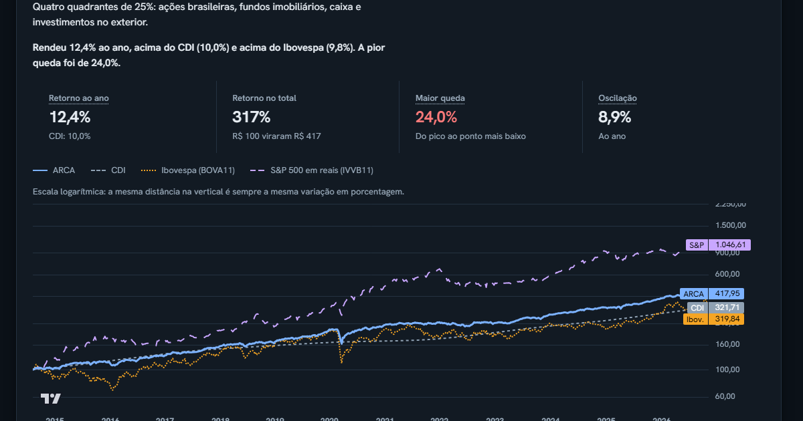

# TradingBot



Painel completo: [docs/img/carteiras-desktop.png](docs/img/carteiras-desktop.png).

Assistente de investimento e backtest de estratégias de swing, com um painel web que mostra, em linguagem simples, o que o bot teria feito em cada operação, para cerca de 200 ativos reais.

> **Simulação com dados históricos, sem envio de ordens e sem recomendação de investimento.** Nada aqui opera dinheiro de verdade. Os dados **não são em tempo real**: foram baixados uma vez e ficam no repositório.

## O que tem aqui

- **Carteiras:** sete metodologias clássicas de alocação (ARCA do Primo Rico, Carteira Permanente, All Weather, Golden Butterfly, 60/40, tendência de 10 meses de Faber e momentum dual de Antonacci) e quatro exemplos montados para objetivos (renda de dividendos, estabilidade, crescimento e swing de alto risco), simulados em reais contra CDI, Ibovespa e S&P 500 em reais. Cada carteira começa na data mais antiga em que todos os seus ativos têm preço (desde 2003 para as que usam só ETFs e ações; desde 2014 para as com FIIs, porque o Yahoo não tem mais que isso), e uma janela comum permite comparar de forma justa. Antes de um ETF existir, um substituto preenche o passado (índice Bovespa, SPY em reais, ouro futuro). Parâmetros publicados, sem otimização, com custo de troca e sem imposto. A tela inicial pergunta o objetivo da pessoa e mostra o exemplo e as metodologias parecidas.
- **Backend (Python):** baixa preços (yfinance), roda três estratégias clássicas por ativo (golden cross 50/200, Donchian 55/20 e momentum de 12 meses) com portão de risco, faz backtest sem olhar o futuro, julga a estratégia só no trecho de teste e exporta os resultados em JSON. Um analista opcional (Claude) escreve um relatório curto por ativo, sempre citando as fontes.
- **Catálogo de ativos:** ações dos EUA e da B3, ETFs, FIIs e criptomoedas (`src/tradingbot/assets.json`). Os 78 ativos validados à mão são a base; o restante vem do S&P 500, do Ibovespa e dos FIIs mais negociados.
- **Painel (React + Vite, em `web/`):** escolha do ativo (por categoria) e da estratégia, visão geral, gráfico de candles com compras e saídas explicadas, tabela de operações, limites de risco e glossário. Site estático: lê os JSON de `web/public/data`.

## Como rodar

Backend (Python 3.11 ou mais novo):

```bash
pip install -e ".[dev]"
python -m pytest
python -m tradingbot backtest SPY --strategy sma_cross --start 2015-01-01 --end 2025-12-31
```

Regenerar os dados do painel (usa a internet e leva alguns minutos):

```bash
python -m tradingbot catalog                                   # remonta a lista de ativos (opcional)
python -m tradingbot export --real --out web/public/data       # baixa os ativos desde o primeiro pregão que o Yahoo tiver e roda as 3 estratégias em cada um (cerca de 200 MB)
python -m tradingbot export --real --limit 3 --out dados-teste # teste rápido, sem apagar nada do que está publicado
python -m tradingbot export --portfolios --out web/public/data # roda as carteiras (baixa ETFs, câmbio e o CDI do Banco Central, desde 1990)
```

Se mais de 25% dos ativos falharem (o Yahoo costuma limitar muitas requisições seguidas), o comando para sem trocar o que já está publicado. `export --synthetic` gera dados de exemplo.

O comando `analyze` usa o Claude e precisa da variável de ambiente `ANTHROPIC_API_KEY`; sem ela, o relatório aparece como indisponível.

Painel:

```bash
cd web
npm install
npm run dev
```

Abra `http://localhost:5173/TradingBot/`. Para testes e build: `npm test` e `npm run build`.

## Configuração

Os limites de risco (risco por operação, posições abertas, perda semanal) e os custos simulados ficam em `config.toml`. São pontos de partida para calibrar, não recomendação.

## Fontes de dados e aviso de uso

- **Preços:** Yahoo Finance, via yfinance, apenas para fins educacionais e sem fins comerciais. Os termos do Yahoo restringem a redistribuição dos dados, então este repositório é uma vitrine de estudo; se você for o dono dos dados e quiser a remoção, abra uma issue.
- **Listas de ativos:** Wikipedia (S&P 500) e brapi.dev (ações da B3 e FIIs).
- **CDI:** API de séries temporais do Banco Central (série 12). Os ETFs em dólar são convertidos pelo câmbio diário do Yahoo.
- **Gráficos:** Lightweight Charts, da TradingView.
- Os dados podem ter erros, atrasos e ajustes de proventos diferentes de outras fontes. O Yahoo não traz os proventos do BOVA11, então o Ibovespa e a fatia de ações brasileiras ficam um pouco subestimados; os FIIs vêm com proventos, mas a cesta usa fundos que existem hoje (viés de sobrevivência).
- Os ativos dos exemplos por objetivo foram escolhidos hoje, sabendo quais prosperaram (viés de sobrevivência): o resultado é otimista, principalmente no swing.
- As estratégias por ativo quase nunca batem comprar e segurar no trecho de teste; isso é um resultado, não um defeito do painel.

## Estrutura

```
src/tradingbot/   backend (dados, estratégias, risco, backtest, avaliação, analyst, catálogo, exportação, CLI)
tests/            testes do backend
web/              painel (código, testes e dados em web/public/data)
DESIGN.md         sistema de design do painel
PRODUCT.md        contexto do produto
```
